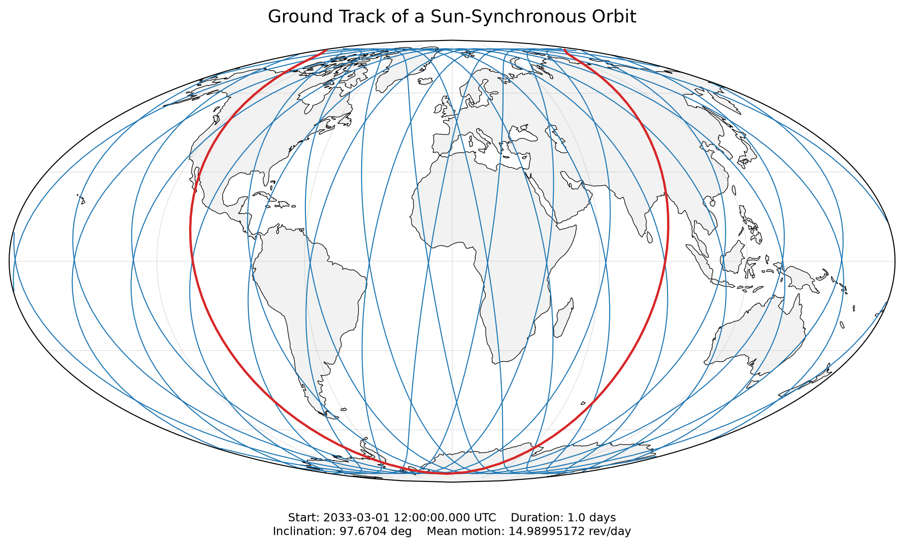

# Satellite Orbit Calculation Example

## Overview

This example generates a synthetic Two-Line Element set (TLE) for a Sun-synchronous low Earth orbit and calculates the satellite ground track using SGP4.

The calculation consists of two steps:

1. `get_tle.py` generates a TLE from the specified orbital altitude, local time of ascending node (LTAN), and reference epoch.
2. `orbit_map.py` propagates the orbit using SGP4 and generates a ground-track map.

The TLE is the intermediate numerical output. It can be reused for orbit propagation and other analyses without regenerating the orbital elements.

The example is intended for preliminary spacecraft design rather than precise operational orbit prediction.

## Directory Structure

```text
examples/orbit/
├── README.md
├── input/
│   └── orbit.json5
└── output/
    ├── orbit.tle
    └── orbit-map.png
```

The input directory contains the orbital configuration, while the output directory contains the generated TLE and ground-track figure.

The calculation programs `get_tle.py` and `orbit_map.py` are located in the repository root directory.

## Simulation Conditions

The example uses the following orbital parameters.

| Parameter | Value |
|---|---|
| Reference epoch | 2033-03-01 12:00:00 UTC |
| Orbital altitude | 570 km |
| Local time of ascending node (LTAN) | 06:00 |
| Orbit type | Sun-synchronous, dawn-dusk |
| Eccentricity | Approximately zero |
| Propagation duration | 1 day |
| Propagation time step | 60 seconds |

The orbital inclination is calculated from the approximate Sun-synchronous condition, including the effect of Earth's J2 gravitational harmonic.

The right ascension of the ascending node (RAAN) is determined from the Sun's right ascension at the reference epoch and the specified LTAN.

The resulting orbital elements are formatted into a synthetic TLE.

## Requirements

The example requires Python 3 and the following packages:

- NumPy
- Astropy
- sgp4
- docopt
- json5
- Matplotlib
- Cartopy

The TLE generation program uses the orbital calculation functions in `lib_sat.py`, while the ground-track program uses SGP4, Astropy, Matplotlib, and Cartopy.

Run the following commands from the repository root directory.

## Generating the TLE

Generate the TLE using the orbital configuration file:

```bash
python get_tle.py \
    --orb examples/orbit/input/orbit.json5 \
    > examples/orbit/output/orbit.tle
```

The input file contains:

```json
{
    "epoch": "2033-03-01 12:00:00",
    "ltan": 6.0,
    "altitude": 570.0,
    "InternationalDesignator": "33001A"
}
```

The generated TLE is:

```text
1 00000U 33001A   33060.50000000  .00000000  00000-0  00000-0 0  9994
2 00000  97.6704 252.2343 0000001 000.0000 090.0000 14.98995172000001
```

The TLE contains the orbital inclination, RAAN, eccentricity, argument of perigee, mean anomaly, and mean motion.

The orbital inclination and mean motion are determined from the specified altitude and approximate Sun-synchronous condition.

The TLE is generated for analysis purposes and does not represent an observed spacecraft orbit.

## Generating the Ground Track

Calculate the satellite ground track over one day:

```bash
python orbit_map.py \
    --tle examples/orbit/output/orbit.tle \
    --days 1 \
    --step 60 \
    -o examples/orbit/output/orbit-map.png
```

When `--start` is omitted, propagation begins at the TLE epoch.

The program performs the following operations:

1. Reads the TLE and initializes the SGP4 propagator.
2. Calculates satellite positions at the specified time intervals.
3. Converts the SGP4 TEME positions into Earth-fixed coordinates using Astropy.
4. Calculates the corresponding geographic latitude and longitude.
5. Displays the ground track using a Mollweide map projection.

The first orbital revolution is highlighted in red, while the complete one-day ground track is shown in blue.

The output figure is shown below.



*Figure 1. Satellite ground track over one day.
The first orbital revolution is highlighted in red.*

### Optional Parameters

The ground-track program supports the following options:

| Option | Description | Default |
|---|---|---|
| `--tle <file>` | Input TLE file | Required |
| `--start <datetime>` | Propagation start time in UTC | TLE epoch |
| `--days <days>` | Propagation duration in days | 1 |
| `--step <seconds>` | Time step in seconds | 60 |
| `-o <outfile>` | Output figure filename | Interactive display |

For example, to calculate a two-day ground track at 120-second intervals:

```bash
python orbit_map.py \
    --tle examples/orbit/output/orbit.tle \
    --days 2 \
    --step 120 \
    -o examples/orbit/output/orbit-map-2days.png
```

## Output Files

### TLE File

`output/orbit.tle` contains two lines of orbital elements in standard TLE format.

It can be read by the Python `sgp4` package or other software supporting TLE-based orbit propagation.

The TLE provides a compact, reusable representation of the assumed orbit.

### Ground-Track Figure

`output/orbit-map.png` shows the satellite ground track over the specified propagation interval.

The figure includes:

- A global Mollweide projection
- Geographic coastlines
- The complete propagated ground track
- The first orbital revolution highlighted in red
- Propagation start time and duration
- Orbital inclination and mean motion

The figure is intended to illustrate the orbit geometry and the approximate repetition of the ground track.

## Reusing the TLE

The generated TLE can be loaded directly into another Python program:

```python
from sgp4.api import Satrec

with open("examples/orbit/output/orbit.tle") as f:
    line1, line2 = f.read().splitlines()

satellite = Satrec.twoline2rv(line1, line2)

jd = satellite.jdsatepoch
fr = satellite.jdsatepochF

error, position, velocity = satellite.sgp4(jd, fr)

if error != 0:
    raise RuntimeError(f"SGP4 error: {error}")

print("Position (TEME, km):", position)
print("Velocity (TEME, km/s):", velocity)
```

The returned position and velocity are expressed in the TEME coordinate system.

They can be transformed into Earth-fixed or other reference frames using Astropy, provided that the appropriate observation time is supplied.

## Assumptions and Limitations

The synthetic TLE is generated using simplified orbital assumptions.

**Sun-synchronous condition.** The orbital inclination is estimated using the first-order J2 nodal precession formula.

**Orbital altitude.** The altitude is used to determine an approximate orbital semi-major axis. The generated orbit is nearly circular.

**LTAN and RAAN.** The orbital plane orientation is calculated using an approximate relationship between LTAN, solar right ascension, and RAAN.

**TLE generation.** The orbital elements are formatted directly into a TLE. They are not fitted to a numerically propagated reference orbit.

**SGP4 propagation.** The resulting trajectory is calculated using SGP4. The accuracy is limited by the approximate synthetic orbital elements and the assumptions underlying their construction.

**Reference frames.** SGP4 returns positions and velocities in TEME coordinates. The ground-track calculation transforms these positions into the Earth-fixed ITRS frame before determining geographic coordinates.

The example is intended to demonstrate a reproducible orbit calculation workflow suitable for preliminary spacecraft geometry studies.
