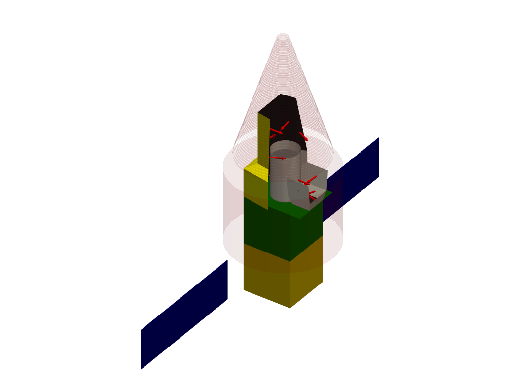
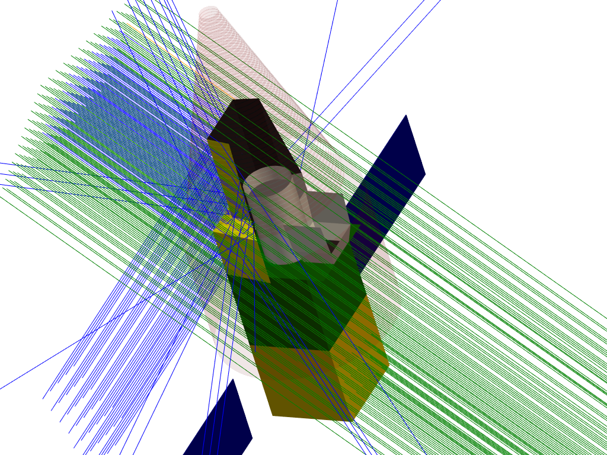
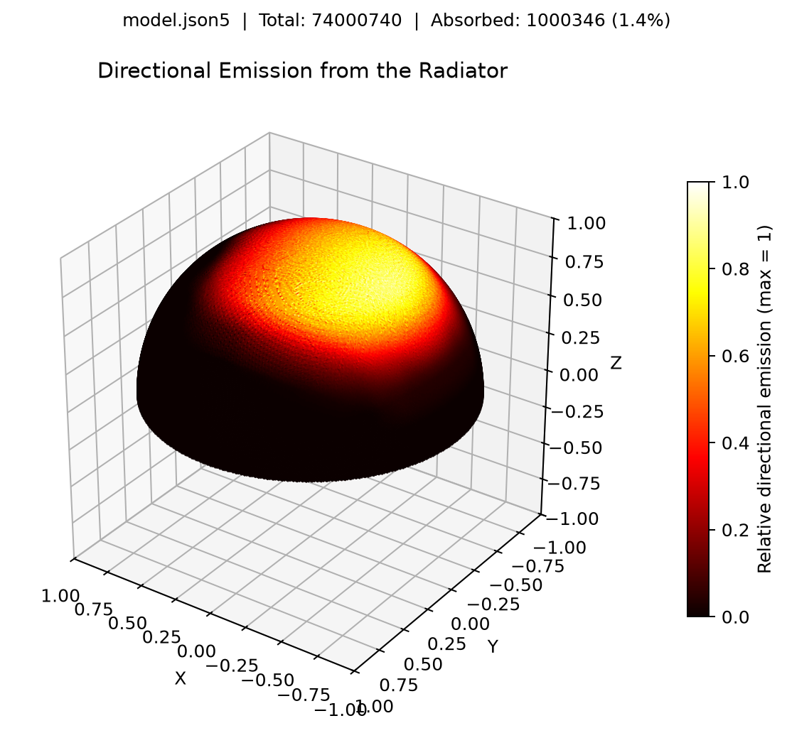
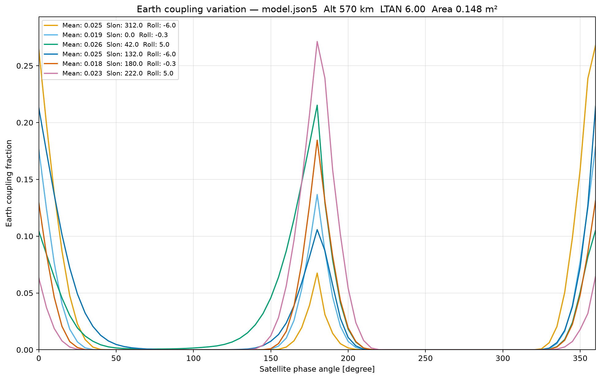

# Three-Dimensional Spacecraft Thermal Radiation Analysis

This example evaluates the radiative performance of a radiator designed to cool the payload
detectors, protected from Earth infrared radiation and direct sunlight by dedicated shields.
It combines a three-dimensional geometric model, ray tracing, directional emission calculations,
and orbit-dependent Earth coupling. A simplified thermal balance then translates
the calculated coupling factors into estimated heat loads and net radiative cooling capacity.

The example is based on an engineering design study of a spacecraft with an Earth-radiation
shield designed to block direct incidence from the ±Y directions up to approximately 45°
elevation.
The calculations are intended for preliminary design assessment, not as a complete transient
thermal model.

## 1. Model and input data

The geometric model is defined in [`input/model.json5`](input/model.json5).
It includes the spacecraft body, telescope and baffle, solar panels, an Earth-radiation shield,
and a Sun shield.
Surface properties are used by the ray tracer to distinguish reflection and absorption.

The Earth-shield cross-section follows the 45° shielding concept examined
in [`../shield-2d/`](../shield-2d/). The three-dimensional model is used to investigate
effects that cannot be represented by the two-dimensional section alone,
including shielding by other spacecraft structures and reflected radiation.

From the repository root, render the model with:

```bash
python model_view.py \
    examples/thermal/3d-model/input/model.json5 \
    -c -o examples/thermal/3d-model/output/model.png
```



*Figure 1. Three-dimensional spacecraft model used for the radiation calculations.*

## 2. Incident-ray tracing: Sun avoidance

The `from_far.py` program traces parallel rays incident on the spacecraft from
a specified direction, including reflection and absorption at modeled surfaces.
This provides a geometric check of whether incident sunlight can reach the radiator.

The direction is specified by a zenith angle `-t` measured from the model's +Z axis and
an azimuth `-p`, both in degrees. For the example Sun direction,
use a zenith angle of 40° (50° elevation above the XY plane) and an azimuth of 11°:

```bash
python from_far.py 3 \
    examples/thermal/3d-model/input/model.json5 \
    -t 40 -p 11 -c --plot-step 3 \
    -o examples/thermal/3d-model/output/from_far_grid.png
```

Level 3 traces a 41 × 41 grid (1,681 incident rays).
The `--plot-step 3` option displays only every third ray along each grid dimension,
without reducing the number of rays used in the calculation.



*Figure 2. Incident-ray tracing for the example Sun direction.
No traced rays reached the radiator in this test.*

The reported result for this test was Radiator 0 out of 1,681 incident rays.
By repeating this analysis for the range of solar incidence angles expected under
the spacecraft's operational conditions, it is possible to verify that direct
sunlight does not reach the radiator throughout the intended operations.

## 3. Directional emission from the radiator

To estimate radiative coupling with the surroundings, `outward_emission.py` launches rays
from a grid of points on the radiator into directions covering the outward hemisphere.
The ray tracer follows reflection and absorption by spacecraft surfaces.
For rays escaping to the far field, the emission-direction distribution is accumulated with
the initial cosine weighting.

The result is a discrete directional distribution representing the effective emission
from the radiator, including geometric shielding and reflections.
It is saved as an NPZ file for reuse in orbital calculations.

```bash
python outward_emission.py \
    examples/thermal/3d-model/input/model.json5 \
    100000 \
    -o examples/thermal/3d-model/output/outward.npz
```

For the example model, the calculation used 1,480 starting points and 100,000 directions,
corresponding to 148 million traced rays. The weighted totals were approximately:

| Quantity | Value |
| --- | ---: |
| Total emitted weight | 74,000,740 |
| Weight absorbed by spacecraft surfaces | 1,000,346 |
| Absorbed fraction of total weight | 1.35% |

These are dimensionless, cosine-weighted ray-tracing totals, not powers in watts.
The absorption fraction is an aggregate over the modeled ray distribution.

Visualize the saved directional distribution with:

```bash
python outward_view.py \
    examples/thermal/3d-model/output/outward.npz \
    -e 30 -a 125 \
    -o examples/thermal/3d-model/output/outward.png
```



*Figure 3. Far-field directional emission distribution. Colors indicate relative directional emission normalized to the maximum displayed value; they do not indicate absolute radiated power.*

## 4. Earth coupling along the orbit

The `earth_sat.py` program combines the directional-emission NPZ file with
the orbit-and-attitude dataset generated by `orb_att.py`.
The orbit-and-attitude dataset is provided in `examples/attitude/output/`,
while the directional-emission dataset is stored in `examples/thermal/3d-model/output/`.
Both files are included in the repository to allow reproduction of the Earth-coupling calculation.

At each orbital phase, the Earth's apparent disk is identified in the spacecraft frame, and the directional weights falling within that disk are summed.

For Earth radius \(R_E\) and spacecraft altitude \(h\), the Earth's apparent angular radius is

\[
\beta = \sin^{-1}\!\left(\frac{R_E}{R_E+h}\right).
\]

The coupling fraction is calculated as

\[
F_{\mathrm{Earth}}(\phi)
= \frac{W_{\mathrm{Earth}}(\phi)}{W_{\mathrm{total}}},
\]

where \(\phi\) is orbital phase, \(W_{\mathrm{Earth}}\) is the accumulated weight in
Earth-facing directions, and \(W_{\mathrm{total}}\) is the total emitted weight.
The result is a geometric radiative coupling fraction, not an incident heat load by itself.

From the repository root, run:
```bash
python earth_sat.py \
    examples/attitude/output/attitude.npz \
    examples/thermal/3d-model/output/outward.npz \
    -o examples/thermal/3d-model/output/earth_coupling.png
```



*Figure 4. Earth coupling fraction versus orbital phase for six seasonal/attitude cases
at 570 km altitude and LTAN 6.0 h. `Slon` in the legend denotes solar longitude,
and `Roll` denotes the roll angle in degrees.*

The orbit-averaged coupling factors obtained in this example are:

| Solar longitude | Roll angle | Mean Earth coupling |
| ---: | ---: | ---: |
| 312° | −6.0° | 0.025 |
| 0° | −0.3° | 0.019 |
| 42° | +5.0° | 0.026 |
| 132° | −6.0° | 0.025 |
| 180° | −0.3° | 0.018 |
| 222° | +5.0° | 0.023 |

The coupling varies strongly with orbital phase and with the seasonal attitude case.
**The value 0.026 used below is the largest orbit-averaged coupling factor among
these six cases, not the maximum instantaneous value in Figure 4.**

## 5. Simplified thermal balance estimate

The directional coupling results can be converted into a preliminary radiative heat budget.
The following calculation adopts a radiator area of 0.148 m²
and a thermal-infrared emissivity/absorptivity of 0.8.

According to the JAXA Spacecraft Thermal Control System Design Standard
(JERG-2-310, Section 5.1.4.1), Earth infrared radiation varies approximately
from 150 to 300 W/m² depending on latitude, season, and weather conditions.
The upper value of 300 W/m² is adopted here as a conservative assumption,
corresponding to an equivalent blackbody temperature of approximately 270 K.

The relevant internal spacecraft surface, on the back side of the sun shield,
is also assumed to be at 270 K for this preliminary estimate.
This internal surface temperature is an independent modeling assumption,
not a value specified by the JAXA standard.

**Reference:** Japan Aerospace Exploration Agency (JAXA), *Spacecraft Thermal Control System Design Standard*, JERG-2-310, Section 5.1.4.1, “External Heat Input Conditions.” [Official PDF](https://sma.jaxa.jp/TechDoc/Docs/JAXA-JERG-2-310_N3.pdf).

### Assumptions

| Parameter | Assumed value | Notes |
| --- | ---: | --- |
| Radiator area, \(S\) | 0.148 m² | Geometric radiator area |
| Radiator thermal emissivity, \(\varepsilon\) | 0.8 | Also used as effective absorptivity in this estimate |
| Radiator temperatures | 190 K and 172 K | Two operating cases |
| Effective Earth temperature | 270 K | Approximate blackbody equivalent of 300 W/m² |
| Maximum orbit-averaged Earth coupling, \(F_{\mathrm{Earth}}\) | 0.026 | Largest mean of the six plotted cases |
| Internal spacecraft coupling, \(F_{\mathrm{internal}}\) | 0.014 | Based on absorption in the ray-tracing model |
| Effective internal surface temperature | 270 K | Assumed for the black surface on the Sun shield |

The total emitted thermal power is estimated using the Stefan–Boltzmann law:

\[
P_{\mathrm{emit}} = \varepsilon \sigma S T^4,
\]

where \(\sigma = 5.67 \times 10^{-8}\ \mathrm{W\,m^{-2}\,K^{-4}}\).

This gives approximately 8.75 W at 190 K and 5.88 W at 172 K.

With the assumed effective environmental temperature \(T_{\mathrm{env}}=270\ \mathrm{K}\), the Earth and internal heat loads are estimated as

\[
P_{\mathrm{Earth}} = \varepsilon\sigma S T_{\mathrm{env}}^4 F_{\mathrm{Earth}},
\qquad
P_{\mathrm{internal}} = \varepsilon\sigma S T_{\mathrm{env}}^4 F_{\mathrm{internal}}.
\]

Numerically,

\[
P_{\mathrm{Earth}} \simeq 0.93\ \mathrm{W}, \qquad
P_{\mathrm{internal}} \simeq 0.50\ \mathrm{W},
\]

so that

\[
P_{\mathrm{in}} = P_{\mathrm{Earth}} + P_{\mathrm{internal}}
\simeq 1.43\ \mathrm{W}.
\]

The **net radiative cooling capacity** is then

\[
P_{\mathrm{net}} = P_{\mathrm{emit}} - P_{\mathrm{in}}.
\]

| Radiator temperature | Emitted power | Estimated incoming power | Net cooling capacity |
| --- | ---: | ---: | ---: |
| 190 K | 8.75 W | 1.43 W | approximately 7.3 W |
| 172 K | 5.88 W | 1.43 W | approximately 4.4 W |

In the original design estimate,
the 172 K net cooling capacity was compared with an assumed detector-side thermal
load of approximately 2.9 W.
Under the stated assumptions, the estimated net cooling capacity exceeds that load.
This is a preliminary steady-state radiative budget, not a prediction of the detector temperature.

### Effect of shortening the observation interval

A supplementary design case reduces the observation interval by 5° of orbital phase
at both its beginning and end. In that case, the largest orbit-averaged Earth coupling
decreases from approximately 0.026 to 0.020.
Using the same internal coupling and effective temperature assumptions gives:

| Quantity | Original interval | Shortened interval |
| --- | ---: | ---: |
| Maximum orbit-averaged Earth coupling | 0.026 | 0.020 |
| Estimated Earth heat load | 0.93 W | 0.71 W |
| Total estimated incoming heat | 1.43 W | 1.21 W |
| Net cooling capacity at 172 K | about 4.4 W | about 4.7 W |

The improvement is modest because internal spacecraft coupling remains
a significant contribution to the estimated heat load.

## 6. Results and limitations

The three-dimensional ray-tracing model indicates that the selected shield configuration
can prevent direct rays from the tested Sun direction from reaching the radiator.
The direction-dependent radiation calculation, combined with the specified orbit
and attitude cases, gives a maximum **orbit-averaged** Earth coupling factor of
approximately 0.026 for the six examined cases.
Under the simplified thermal assumptions,
the radiator has an estimated net cooling capacity of approximately 4.4 W at 172 K.

Important limitations include:

- Sun avoidance should be verified by repeating the ray-tracing analysis over
the full range of solar incidence angles expected under the spacecraft's operational conditions,
with sufficient ray sampling for each case.
- The Earth-coupling curve is geometric; conversion to heat input requires separate assumptions
about infrared radiance and absorptivity.
- The 270 K temperature of the internal Sun-shield surface is an assumption,
not a calculated equilibrium temperature.
- The thermal balance uses orbit-averaged coupling and does not resolve temperature
variations during an orbit.
- Conductive heat paths, detailed surface spectral properties,
and transient detector/spacecraft thermal behavior are not included in this estimate.
- Orbit altitude, LTAN, observation scheduling, and the internal shield design can
change the result.

The scripts and plots therefore support an early-stage comparison of shielding
concepts and thermal margins, rather than a final thermal verification.
