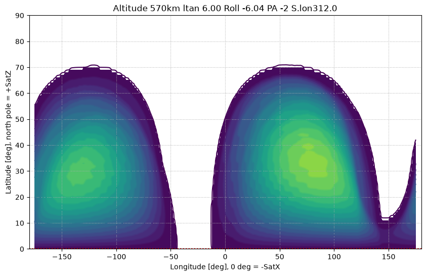
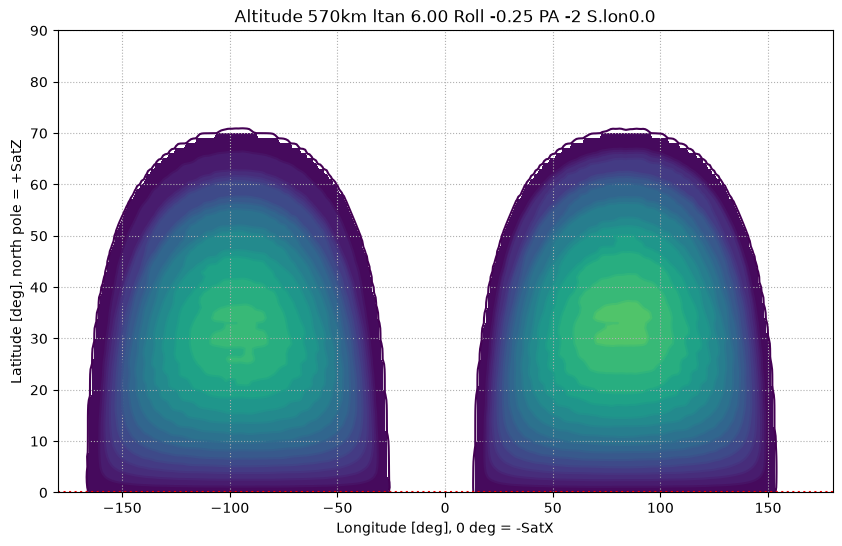
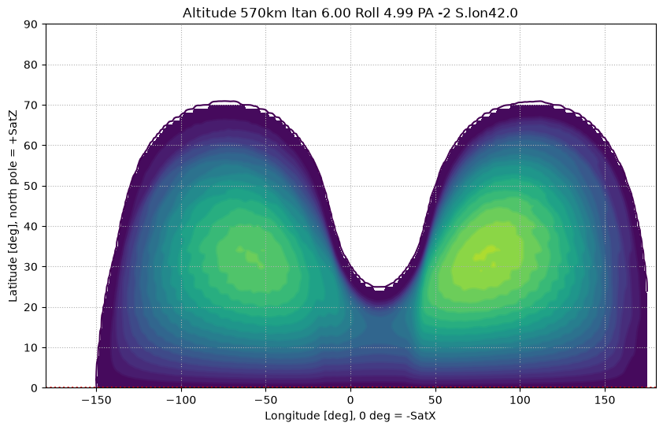
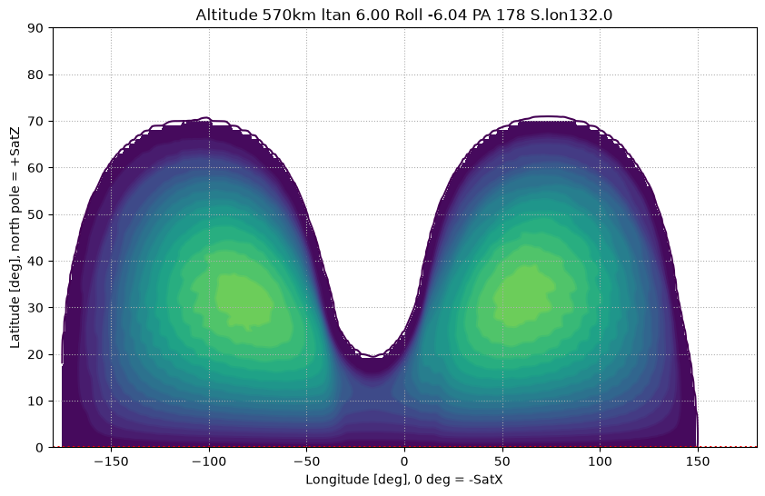
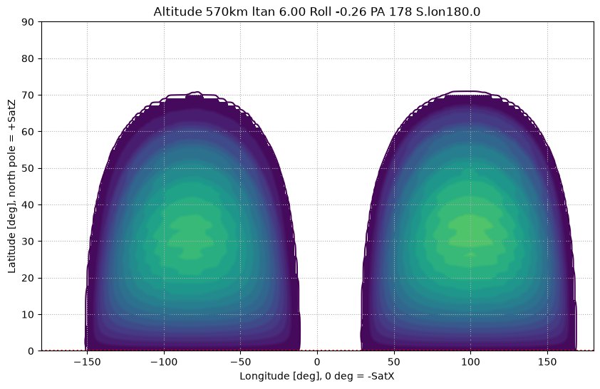
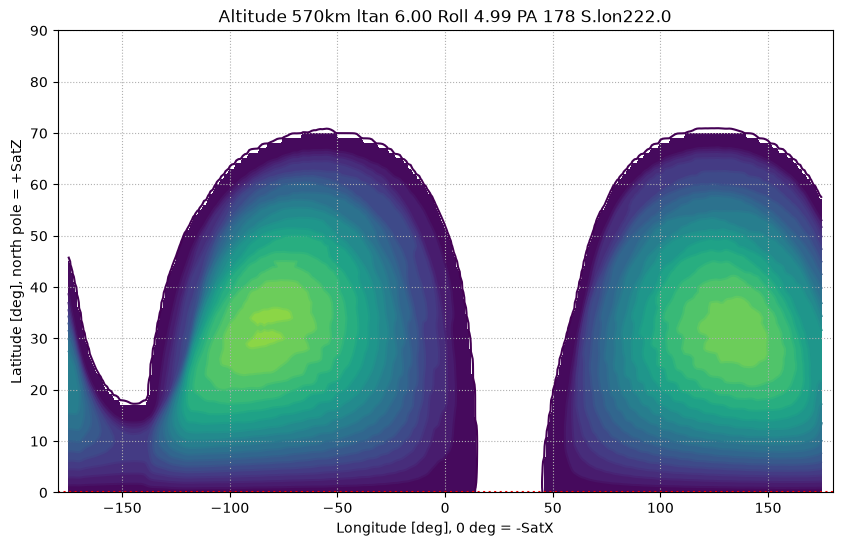

# Earth Radiation Coupling: Dice Satellite Model

## Overview

This example examines the directions from which Earth infrared radiation can reach a spacecraft
radiator during orbital operation. A simplified *dice satellite* (cube-shaped spacecraft)
model is used before introducing the detailed geometry of the radiator and its thermal shields.

The main objective is to identify the incident directions that should be considered in radiator
and shield design.
In particular, the analysis shows how Earth coupling depends on orbital phase,
spacecraft attitude, and season, represented by the solar ecliptic longitude.

This is a directional, geometrical coupling study. It does **not** calculate an absolute
heat load in watts or model the detailed shield geometry.

## Method

The calculation is implemented in [`earth_coupling.py`](../../../earth_coupling.py).

1. Calculate the spacecraft orbit and prescribed attitude at 72 intervals over one
revolution (73 sampled positions including the endpoint).
2. Generate 200,000 approximately uniformly distributed directions on a sphere using
a Fibonacci distribution.
3. At each orbital position, transform the direction toward the Earth into spacecraft coordinates.
4. For each sampled direction in the +Z hemisphere, determine whether it falls within
the apparent disk of the Earth.
5. Accumulate the positive Z component of directions that intersect the Earth,
and display the resulting directional coupling map.

The accumulated quantity is proportional to a cosine-weighted directional exposure count
over the sampled orbit. It is not normalized to a physical view factor or converted into
radiative power.

The directional map uses spacecraft coordinates: +Z is the north pole, and
longitude 0° corresponds to −X. The displayed map covers elevations from 0° to 90°
above the XY plane, corresponding to the +Z hemisphere.

## Example Conditions

The representative cases use the same orbit and attitude configuration files as
the orbit and attitude examples.

| Parameter | Value |
| --- | --- |
| Orbit | Sun-synchronous orbit |
| Altitude | 570 km |
| LTAN | 06:00 |
| Observation target | Galactic Center |
| Target position-angle parameter | −2° |
| Solar ecliptic longitude | 312°, 0°, 42°, 132°, 180°, 222° |
| Orbital sampling | 72 intervals per revolution |
| Directional sampling | 200,000 directions |

The solar-longitude values represent six orbital/seasonal conditions.
They are also used in the [spacecraft attitude example](../../attitude/README.md).

## Directory Structure

```text
on-orbit-radiator-analysis/
├── earth_coupling.py
├── examples/
│   ├── orbit/
│   │   └── input/
│   │       ├── orbit.json5
│   │       └── GC_pos.json5
│   └── thermal/
│       └── dice/
│           ├── README.md
│           └── output/
│               └── earth_coupling_*.png
```

The example plots are stored in `examples/thermal/dice/output/`. The program itself is located at the repository root.

## Requirements

Python 3 with NumPy, SciPy, sgp4, Matplotlib, docopt, and json5,
together with the dependencies of the shared orbit/attitude modules.
See the [repository README](../../../README.md) for the overall software requirements.

## Running the Calculation

Run the following commands from the repository root.

For example, calculate the Earth-coupling map at solar ecliptic longitude 0°:

```bash
python earth_coupling.py \
    --orb examples/orbit/input/orbit.json5 \
    --obj examples/orbit/input/GC_pos.json5 \
    --ltan 6 --alt 570 --sln 0 --tpa -2 \
    -o examples/thermal/dice/output/earth_coupling_test.png
```

To generate maps for all six solar longitudes with distinct filenames:

```bash
for sln in 312 0 42 132 180 222; do
    python earth_coupling.py \
        --orb examples/orbit/input/orbit.json5 \
        --obj examples/orbit/input/GC_pos.json5 \
        --ltan 6 --alt 570 --sln "$sln" --tpa -2 \
        -o "examples/thermal/dice/output/earth_coupling_sln${sln}.png"
done
```

These filenames are suggested for newly generated plots;
the existing example images may use different names.
The script also opens a Matplotlib figure when it runs.

The optional `--dly` argument changes the duration of the observation interval in
the prescribed attitude calculation. It can be used to examine the effect of shortening
the observation period; its interpretation is defined by the attitude-model implementation.


## Directional Earth-Coupling Maps

The following figures show the directional Earth-radiation coupling
for six solar ecliptic longitudes.

<table>
<tr>
<td align="center">
  <br>
  Solar longitude: 312°
</td>
<td align="center">
  <br>
  Solar longitude: 0°
</td>
<td align="center">
  <br>
  Solar longitude: 42°
</td>
</tr>
<tr>
<td align="center">
  <br>
  Solar longitude: 132°
</td>
<td align="center">
  <br>
  Solar longitude: 180°
</td>
<td align="center">
  <br>
  Solar longitude: 222°
</td>
</tr>
</table>

The maps show the accumulated cosine-weighted directional exposure
to Earth radiation over one orbital revolution.

## Results and Design Implications

The simplified analysis highlights several features relevant to the radiator and shield design:

- Earth coupling is particularly significant from directions near the spacecraft's **±Y axes**.
- For the examined orbit and attitude conditions, Earth radiation can reach directions at
elevations approaching **70° above the radiator plane**.
- For some seasonal conditions, coupling also occurs from near the **−X direction**,
at elevations exceeding approximately **20°**.
- Shortening the observation interval near its boundaries can reduce the highest
Earth-incidence elevations, at the cost of observing time.

These findings motivate the subsequent study of reflective shield geometries,
especially their ability to reject radiation arriving at high elevation angles from
the ±Y directions.

See [Two-Dimensional Thermal Shield Analysis](../shield-2d/README.md) for the next design step and [Three-Dimensional Radiator Analysis](../3d-model/README.md) for the more detailed geometrical and thermal evaluation.

## Scope and Limitations

The spacecraft is represented through its attitude coordinate system rather than a detailed three-dimensional surface model. The Earth is treated as a spherical disk of uniform angular extent, and the directional exposure is accumulated with a cosine weight. No spectral radiance, surface absorptivity/emissivity, reflection, or conductive heat transfer is included in this example.

Consequently, the maps are best interpreted as **directional screening information for radiator/shield design**, not as final thermal-load predictions.
