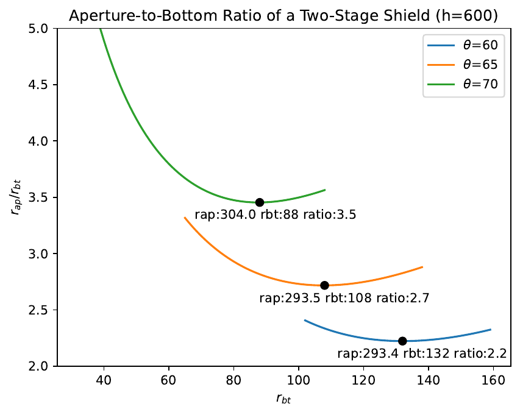
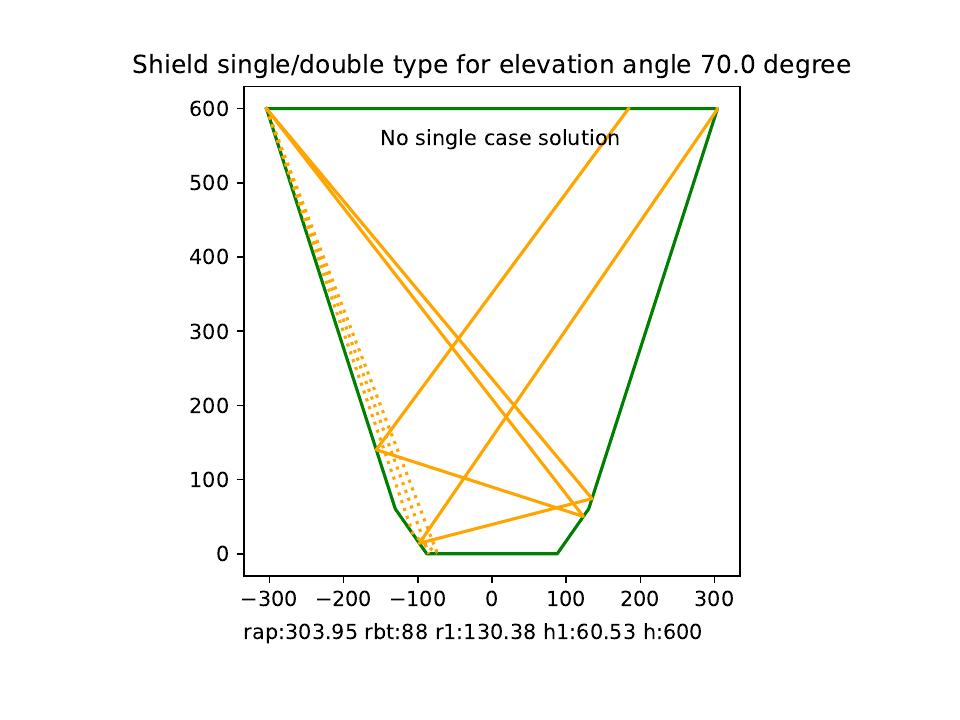
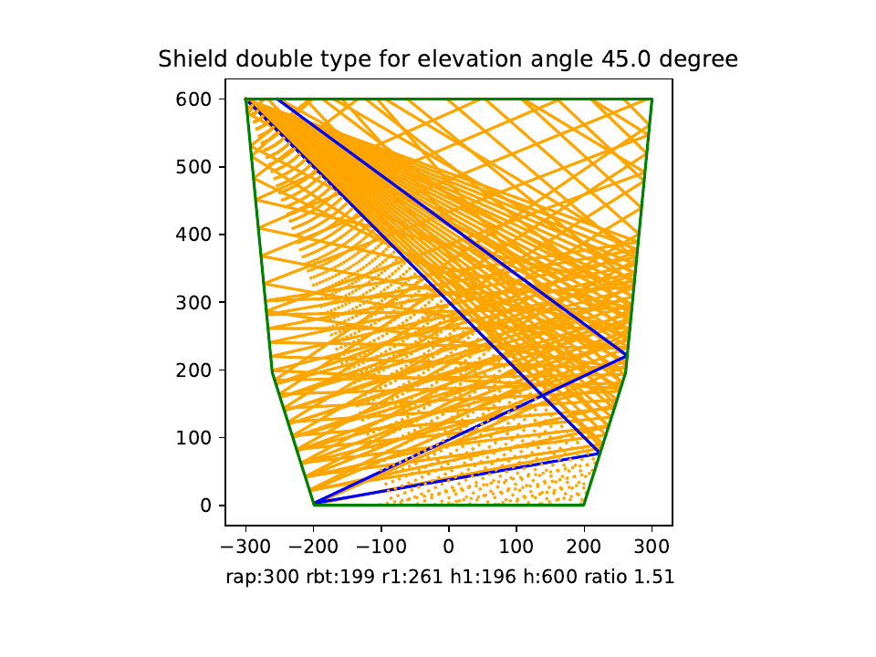

# Two-Dimensional Thermal Shield Analysis

## Overview

This example investigates the geometry of a reflective thermal shield intended to reduce
Earth infrared radiation incident on a spacecraft radiator.

A preliminary analysis using a dice-shaped satellite model showed that Earth radiation
contributes primarily from the spacecraft's ±Y directions. The incident radiation extends to
elevations of approximately 70° above the radiator plane, with the largest contribution
occurring near 30°.

These results motivate the investigation of shield geometries capable of rejecting radiation
arriving at relatively high elevation angles.

The purpose of this example is to examine the trade-off between the maximum rejected
elevation angle and the available radiator area.

Two types of reflective shields are considered:

- A single-stage conical shield.
- A two-stage conical shield.

The analysis is performed using two-dimensional cross-sectional models and specular ray tracing.

## Directory Structure

The calculation programs are located in `shield2d/`, while the example results are stored
in `examples/thermal/shield-2d/`.

```text
on-orbit-radiator-analysis/
├── shield2d/
│   ├── lib_shield.py
│   ├── ratio2ss.py
│   ├── shield.py
│   └── modelshield.py
└── examples/
    └── thermal/
        └── shield-2d/
            ├── README.md
            └── output/
                ├── ratio2ss.pdf
                ├── ratio2ss.png
                ├── s55.pdf
                ├── s59.pdf
                ├── s65.pdf
                ├── s70.pdf
                ├── s70.png
                ├── s45.pdf
                └── s45.png
```

The three executable programs share the geometric calculations and ray-tracing functions
provided by `lib_shield.py`.

## Shield Geometry

The shield is modeled as a reflective cup with a flat radiator at its bottom.

The following geometric parameters are used:

| Parameter | Description |
|---|---|
| \(r_{\rm ap}\) | Aperture radius |
| \(r_{\rm bt}\) | Bottom (radiator) radius |
| \(r_1\) | Radius at the transition between the two stages |
| \(h_1\) | Height of the transition |
| \(h\) | Total shield height |
| \(\theta\) | Incident elevation angle measured from the radiator plane |

For a single-stage shield, the side wall is a straight line connecting the bottom and aperture.

For a two-stage shield, the wall consists of two straight segments with different slopes.

The shield walls are assumed to be specular reflectors. Incident rays may undergo multiple
reflections before either escaping through the aperture or reaching the radiator.

The limiting elevation angle is defined so that rays incident at or below that angle are
rejected by the shield under the geometric conditions considered.

## Single-Stage and Two-Stage Shields

For the single-stage conical shield, the limiting geometry satisfies

\[
\tan\theta=\frac{h}{r_{\rm ap}+r_{\rm bt}},
\qquad
\phi=\frac{\theta}{2},
\qquad
\tan\phi=\frac{r_{\rm ap}-r_{\rm bt}}{h}.
\]

Here, \(\phi\) is the inclination of the shield wall.

A physically meaningful solution with a nonnegative bottom radius exists only for
limiting elevation angles of 60° or less.

The two-stage shield introduces additional geometric freedom through
\(r_1\) and \(h_1\), allowing higher limiting elevation angles.

The geometry is determined by conditions on critical ray paths, including reflections at
the lower and upper wall segments.

The corresponding equations are implemented in `lib_shield.py`.

A continuously curved reflector, such as a Winston cone, represents a possible extension
of this geometric approach. The present example is restricted to one- and two-stage
straight-wall models.

## Requirements

The programs require Python 3 and the following packages:

- NumPy
- SciPy
- Matplotlib
- docopt

All commands below are executed from the repository root directory.

## Aperture-to-Bottom Ratio

The program `ratio2ss.py` evaluates the aperture-to-bottom radius ratio for two-stage
shields at specified limiting elevation angles.

For a shield height of 600, run:

```bash
python shield2d/ratio2ss.py \
    --height 600 \
    --angles 60,65,70 \
    -o examples/thermal/shield-2d/output/ratio2ss.pdf
```

The program calculates the ratio

\[
R=\frac{r_{\rm ap}}{r_{\rm bt}}
\]

as a function of bottom radius and identifies the minimum ratio for each limiting elevation angle.

The representative results are:

| Limiting elevation | Aperture radius | Bottom radius | Radius ratio |
|---|---:|---:|---:|
| 60° | 293.4 | 132 | 2.2 |
| 65° | 293.5 | 108 | 2.7 |
| 70° | 304.0 | 88 | 3.5 |

All dimensions are in the same arbitrary length unit, with \(h=600\).

The ratio increases substantially as the required limiting elevation angle approaches 70°.

[](output/ratio2ss.pdf)

*Figure 1. Aperture-to-bottom radius ratio for two-stage
reflective shields with limiting elevation angles of 60°,
65°, and 70°. The total shield height is fixed at 600.*


For circular apertures and radiator surfaces, the corresponding area ratio is

\[
\frac{A_{\rm bt}}{A_{\rm ap}}
=\left(\frac{r_{\rm bt}}{r_{\rm ap}}\right)^2.
\]

Thus, the available radiator area relative to the aperture area is approximately:

| Limiting elevation | Radiator area / Aperture area |
|---|---:|
| 60° | 20% |
| 65° | 14% |
| 70° | 8% |

This illustrates the significant geometric penalty associated with rejecting radiation
at high elevation angles.

## Comparison of Single-Stage and Two-Stage Shields

The program `shield.py` calculates shield geometries and traces representative incident rays.

The following commands reproduce the four comparison figures:

```bash
for angle in 55 59 65 70; do
    python shield2d/shield.py \
        --angle "$angle" \
        --height 600 \
        -o "examples/thermal/shield-2d/output/s${angle}.pdf"
done
```

The resulting figures are:

- `s55.pdf`: Comparison at 55°.
- `s59.pdf`: Comparison at 59°.
- `s65.pdf`: Two-stage solution at 65°.
- `s70.pdf`: Two-stage solution at 70°.

At 55° and 59°, both single-stage and two-stage solutions are available.

At 65° and 70°, the single-stage geometry has no physically meaningful solution under
the assumed conditions, whereas the two-stage geometry remains feasible.

The ray-tracing diagrams illustrate the reflection paths associated with the limiting
elevation angles.

[](output/s70.pdf)

*Figure 2. Cross-sectional geometry and ray trajectories
for a two-stage reflective shield with a limiting elevation
angle of 70°. The total shield height is 600.*

## Evaluation of a 45° Shield

The high-elevation solutions provide strong geometric rejection of incident Earth
radiation, but they leave relatively small radiator surfaces.

A less restrictive design is therefore investigated by reducing the limiting
elevation angle to 45°.

The program `modelshield.py` traces rays through a shield with explicitly specified
geometric parameters.

Run:

```bash
python shield2d/modelshield.py \
    -a 300 -b 199 -r 261 -l 196 \
    --height 600 --angle 45 \
    -o examples/thermal/shield-2d/output/s45.pdf
```

The model parameters are:

| Parameter | Value |
|---|---:|
| \(r_{\rm ap}\) | 300 |
| \(r_{\rm bt}\) | 199 |
| \(r_1\) | 261 |
| \(h_1\) | 196 |
| \(h\) | 600 |
| Limiting elevation | 45° |

The aperture-to-bottom radius ratio is approximately 1.51.

For circular surfaces, the bottom area is approximately 44% of the aperture area,
considerably larger than the 8% obtained for the 70° shield.

The ray-tracing results show that rays at or below the specified limiting elevation are
rejected in the modeled cross section, while some rays arriving at higher elevations
can reach the radiator.

This configuration does not eliminate all Earth radiation.
Instead, it demonstrates a possible compromise between shielding performance and
available radiator area.

[](output/s45.pdf)

*Figure 3. Cross-sectional geometry and ray trajectories
for a two-stage reflective shield with a limiting elevation
angle of 45°. The larger bottom radius preserves more
radiator area while allowing some higher-elevation radiation
to reach the radiator.*

## Design Implications

Figures 1–3 illustrate the geometric trade-off between shielding performance and
available radiator area.

Rejecting Earth radiation up to approximately 70° requires a relatively narrow bottom
opening compared with the aperture. Consequently, the available radiator area becomes small.

Reducing the limiting elevation angle allows a substantially larger radiator area,
at the expense of admitting some higher-elevation radiation.

The preceding dice-satellite analysis indicates that the strongest Earth-radiation
contribution occurs near an elevation of 30°, while contributions extend to approximately 70°.

Therefore, complete geometric rejection of all potentially incident Earth radiation may not
be the best design objective.

A more practical approach is to accept some residual Earth radiation while preserving
sufficient radiator area for heat rejection.

The final balance must be evaluated using the actual spacecraft geometry and
the directional distribution of Earth radiation over the orbit.

## Assumptions and Limitations

The present analysis uses an idealized two-dimensional model.

The principal assumptions are:

- Shield walls are perfectly specular reflectors.
- The radiator is represented by a flat bottom surface.
- Ray propagation is treated geometrically.
- The modeled cross section is symmetric about its central axis.
- The effects of finite reflectivity, absorption, surface roughness,
and thermal emission from the shield walls are not included.
- The calculations evaluate geometric shielding rather than absolute thermal power.

The two-dimensional results do not directly establish the performance of a complete
three-dimensional spacecraft shield.

In particular, a practical spacecraft may require shielding primarily along the ±Y
directions rather than a fully axisymmetric conical structure.

The analysis therefore serves as a preliminary geometric study for selecting and
evaluating shield concepts.
